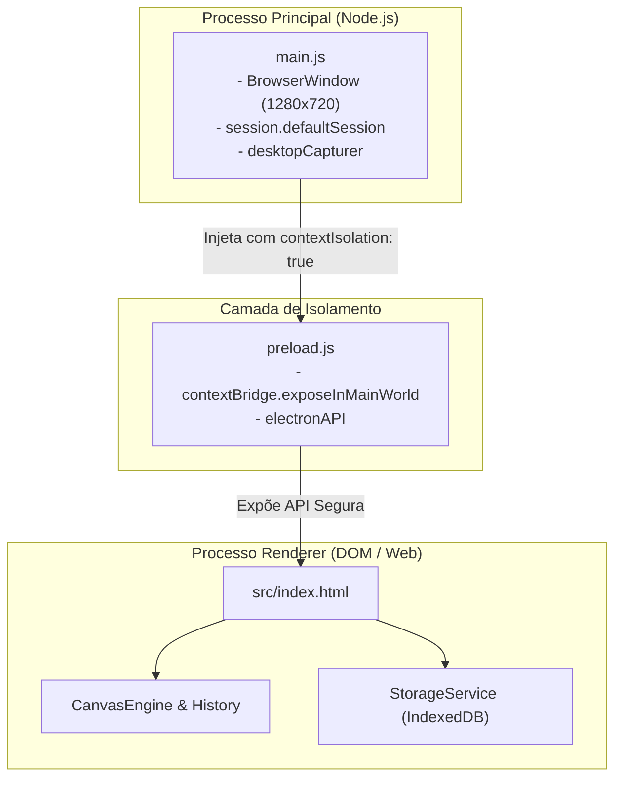
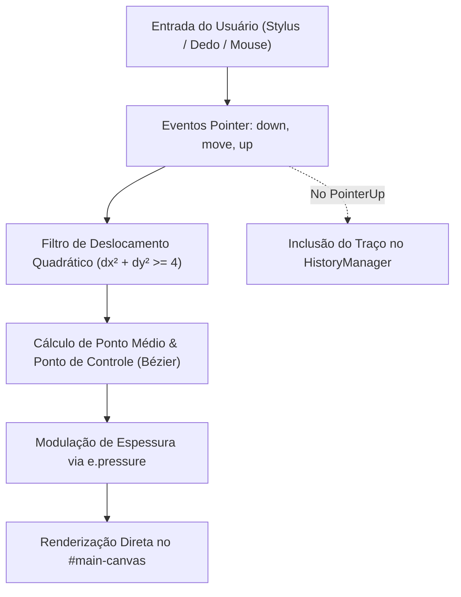
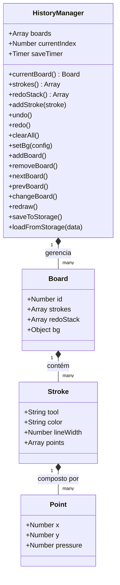
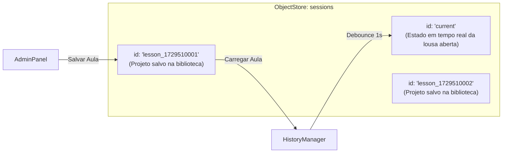
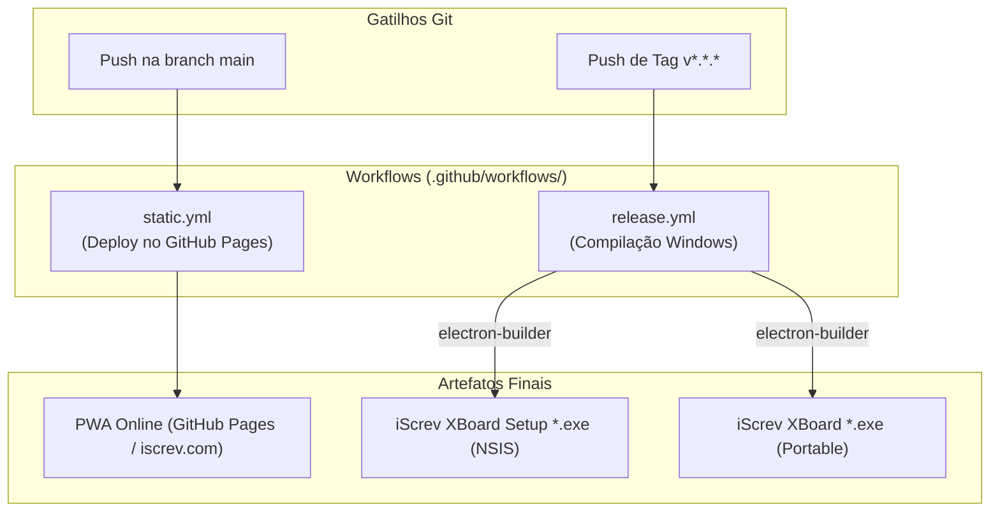

# Documentação Arquitetural e Técnica do Projeto: iScrev XBoard

> **Versão Base Analisada:** v1.4.1  
> **Status:** Produção Estável (Desktop & PWA)  
> **Autor & Mantenedor:** Wandeson Ricardo (WSRicardo)  
> **Destino Deste Documento:** Planejamento e Base Técnica para o Desenvolvimento da Versão 2.0 (`src/v2.0/`)  
> **Data de Análise:** Outubro de 2026  

---

## 1. Visão Geral Executiva

O **iScrev XBoard** é uma plataforma híbrida de lousa digital interativa projetada para atender ambientes educacionais, treinamentos corporativos, palestras e conferências digitais. Concebida sob a metáfora estética e filosófica da *"Lousa Digital do Renascimento Moderno"*, a aplicação combina traço manual de alta fidelidade visual com recursos multimídia integrados de gravação e exportação.

### 1.1. Premissas Arquiteturais Fundamentais
1. **Performance Extrema e Baixa Latência:** A latência entre a entrada física do usuário (caneta stylus, dedo ou mouse) e a resposta do traço na tela é o fator mais crítico em uma lousa digital. Para eliminar a sobrecarga de frameworks reativos pesados (como React, Angular ou Vue), o projeto foi desenvolvido em **Vanilla JavaScript (ES6+)**, explorando a API Canvas 2D acelerada por hardware com a flag `desynchronized: true`.
2. **Dualidade de Plataforma (PWA & Electron):** A base de código é unificada. O mesmo código-fonte em `src/` opera como um **Progressive Web App (PWA)** offline-first acessível diretamente via navegador e é empacotado como uma aplicação **Desktop nativa Windows** via Electron.
3. **Persistência Vetorial Contínua:** Diferente de softwares que tratam anotações como imagens estáticas (pixels rasterizados), o XBoard preserva as anotações como estruturas de dados vetoriais contendo coordenadas, espessura e sensibilidade à pressão física, viabilizando paginação fluida, *Undo/Redo* determinístico e redimensionamento sem perda de nitidez.
4. **Isolamento de Segurança e Recursos Nativos:** No ecossistema Desktop, o Electron opera com isolamento de contexto estrito (`contextIsolation: true`, `nodeIntegration: false`), gerenciando permissões transparentes para captura de tela e áudio do microfone.

---

## 2. Topologia de Arquivos e Mapeamento do Repositório

A estrutura física do repositório é organizada de forma a desacoplar os processos do Electron, as regras de negócio da aplicação e a infraestrutura de distribuição:

```text
iScrev-XBoard/
├── .github/
│   ├── FUNDING.yml                  # Configuração de patrocínio e apoio financeiro
│   └── workflows/
│       ├── release.yml              # CI/CD: Geração automática de instaladores Electron para Windows
│       └── static.yml               # CI/CD: Deploy estático automatizado no GitHub Pages
├── docs/                            # Landing Page oficial e material de apresentação pública
│   ├── assets/                      # Imagens promocionais e hero banner
│   ├── css/landing.css              # Estilos visuais da landing page
│   └── index.html                   # Ponto de entrada da página de divulgação
├── Relatorio-XBoard/                # Relatórios técnicos anteriores de referência
│   ├── api-detalhada.md & .pdf      # Detalhamento de APIs da versão 1.x
│   └── resumo.md & .pdf             # Síntese das características do sistema
├── specs/                           # Especificações técnicas originais
│   ├── specs.md                     # Documentação inicial de especificações
│   └── specs.pdf                    # Documento compilado
├── main.js                          # Processo Principal (Main Process) do Electron
├── preload.js                       # Script de pré-carregamento e ponte de segurança (ContextBridge)
├── package.json                     # Metadados do projeto, dependências e scripts de automação
├── package-lock.json                # Bloqueio estrito de versões das dependências
├── LICENSE                          # Termos de licenciamento (ISC / GPLv3)
├── README.md                        # Documentação pública para usuários e desenvolvedores
└── src/                             # Aplicação Frontend / Renderer Process (PWA)
    ├── index.html                   # Estrutura DOM, modais nativos e carregamento de scripts
    ├── manifest.json                # Manifesto PWA com metadados para instalação e tela cheia
    ├── sw.js                        # Service Worker com estratégia de cache Stale-While-Revalidate
    ├── assets/
    │   └── icons/                   # Ícones nos formatos 192x192 e 512x512 para o PWA
    ├── icons/
    │   └── icon.ico                 # Ícone compilado para executáveis Windows Desktop
    ├── css/
    │   ├── style.css                # Estilos globais, canvas, toolbar em Glassmorphism e responsividade
    │   └── modals.css               # Estilos para modais nativos <dialog> e painéis administrativos
    ├── js/
    │   ├── core/                    # Motores fundamentais de desenho e estado
    │   │   ├── canvas-engine.js     # Motor gráfico, suavização Bézier e eventos de ponteiro
    │   │   └── history.js           # Gerenciador de pranchetas (boards) e máquina do tempo (Undo/Redo)
    │   ├── modules/                 # Funcionalidades satélites desacopladas
    │   │   ├── admin-panel.js       # Controle da biblioteca de aulas e persistência em lote
    │   │   ├── background-manager.js# Renderização de fundos (sólido, pautado/caderno, quadriculado)
    │   │   ├── i18n.js              # Sistema dinâmico de internacionalização (PT-BR e EN)
    │   │   ├── media-viewer.js      # Visualizador nativo de mídias (leitor PDF e player de vídeo)
    │   │   ├── pdf-exporter.js      # Motor de compilação da aula para documento PDF A4 em Paisagem
    │   │   ├── pwa-manager.js       # Gerenciador de ciclo de vida do PWA e atualizações em segundo plano
    │   │   ├── recorder.js          # Estúdio de gravação audiovisual integrado (MediaRecorder)
    │   │   └── ui-manager.js        # Maestro de eventos do DOM e controle responsivo da toolbar
    │   ├── services/
    │   │   └── storage.js           # Camada de persistência assíncrona baseada em IndexedDB nativo
    │   └── libs/
    │       └── jspdf.umd.min.js     # Biblioteca standalone para geração de documentos PDF no cliente
    └── v2.0/                        # Diretório reservado para planejamento e especificações da v2.0
        ├── README.md                # Diretrizes do escopo da nova versão
        └── DOCUMENTATION.md         # Este documento técnico detalhado
```

---

## 3. Arquitetura do Ambiente Desktop (Electron)

A versão Desktop é alimentada pelo Electron (v28.0.0), projetada para garantir segurança nativa sem abrir mão da simplicidade de distribuição.



### 3.1. Configuração do Processo Principal ([main.js](file:///c:/Users/wsric/OneDrive/Documentos/GitHub/iScrev-XBoard/main.js))
- **Segurança de Execução:** `nodeIntegration: false` e `contextIsolation: true` garantem que o DOM do frontend não tenha acesso arbitrário a módulos internos do Node.js (como `fs`, `child_process`), prevenindo ataques de execução remota de código via injeção.
- **Suporte a Webviews:** A propriedade `webviewTag: true` está habilitada para isolar a renderização de conteúdos externos e players de vídeo sem herdar o contexto da lousa.
- **Imersão Visual:** `autoHideMenuBar: true` remove a barra clássica do Windows (Arquivo, Editar, etc.), permitindo que a aplicação assuma um aspecto focado de estúdio.
- **Tratamento de Permissões de Mídia:**
  ```javascript
  session.defaultSession.setPermissionRequestHandler((webContents, permission, callback) => {
    if (permission === 'media') {
      return callback(true);
    }
    callback(true);
  });
  ```
  Permite que o microfone seja ativado sem exibir caixas de diálogo nativas repetitivas ao professor.
- **Captura de Tela Transparente:**
  ```javascript
  session.defaultSession.setDisplayMediaRequestHandler((request, callback) => {
    desktopCapturer.getSources({ types: ['screen'] }).then((sources) => {
      callback({ video: sources[0], audio: 'loopback' });
    });
  });
  ```
  Permite que a API padrão do navegador `getDisplayMedia` seja atendida pelo Electron sem necessitar de telas de seleção complexas, selecionando a tela primária e o áudio de loopback do sistema operacional.

### 3.2. Ponte de Contexto ([preload.js](file:///c:/Users/wsric/OneDrive/Documentos/GitHub/iScrev-XBoard/preload.js))
O arquivo implementa o padrão `contextBridge.exposeInMainWorld('electronAPI', {})`. No estágio atual (v1.4.1), ele reserva a ponte para a futura introdução de salvamento de arquivos via caixa de diálogo do sistema operacional (`ipcRenderer.invoke('dialog:saveFile')`).

---

## 4. Núcleo Gráfico (Core Engine) e Pipeline de Renderização

O motor gráfico reside em `src/js/core/` e é composto pela dobradinha `CanvasEngine` e `History`.

### 4.1. Arquitetura Dual-Canvas
A interface gráfica separa o plano de fundo do plano de desenho ativo por meio de duas tags `<canvas>` sobrepostas no mesmo espaço de coordenadas:

| Elemento | ID DOM | Z-Index | Contexto 2D | Responsabilidade |
| :--- | :--- | :--- | :--- | :--- |
| **Canvas de Fundo** | `#bg-canvas` | `1` | `{ alpha: false }` | Renderização opaca de cores sólidas, texturas de linhas (caderno) ou grades (quadriculado). É estático durante a escrita. |
| **Canvas de Desenho** | `#main-canvas` | `2` | `{ desynchronized: true }` | Superfície transparente onde residem os traços do usuário. Utiliza `desynchronized` para reduzir latência de hardware. |



### 4.2. Suavização Geométrica com Curvas Quadráticas de Bézier
Em vez de desenhar segmentos retos primitivos entre cada par de coordenadas recebido (o que geraria traços angulares e pixelizados), a classe [CanvasEngine](file:///c:/Users/wsric/OneDrive/Documentos/GitHub/iScrev-XBoard/src/js/core/canvas-engine.js) implementa interpolação em tempo real:
1. Ao registrar o primeiro ponto (`pointerdown`), inicializa as variáveis de controle `lastX`, `lastY`, `controlX`, `controlY`.
2. A cada evento de movimento (`pointermove`), calcula o ponto médio entre a posição anterior e a nova coordenada:
   $$\text{midX} = \text{lastX} + \frac{x - \text{lastX}}{2}, \quad \text{midY} = \text{lastY} + \frac{y - \text{lastY}}{2}$$
3. Executa o comando nativo:
   ```javascript
   this.ctx.quadraticCurveTo(this.lastX, this.lastY, midX, midY);
   ```
   onde o ponto anterior atua como âncora de atração (ponto de controle) e o ponto médio atua como a ponta da curva, suavizando cantos abruptos.

### 4.3. Sensibilidade à Pressão Dinâmica
A espessura da linha é calibrada frame a frame baseando-se no valor reportado pelo hardware da caneta stylus (`e.pressure`, variando de `0.0` a `1.0`, com valor de segurança padrão de `0.5` para mouses convencionais):
```javascript
this.ctx.lineWidth = this.currentLineWidth * (pressure * 2);
```
Isso confere dinamismo e expressividade idênticos a canetas tradicionais de ponta macia.

### 4.4. Mecânica da Ferramenta Borracha
Para que a borracha funcione sem pintar pixels brancos sobre fundos customizados (como fundo verde, preto ou quadriculado), o `CanvasEngine` alterna a propriedade de composição global:
- **Caneta (`pen`):** `globalCompositeOperation = 'source-over'` e `strokeStyle = this.currentColor`.
- **Borracha (`eraser`):** `globalCompositeOperation = 'destination-out'` e `strokeStyle = 'rgba(0,0,0,1)'`.
O efeito `destination-out` torna a região do traço 100% transparente, revelando a camada subjacente `#bg-canvas`.

### 4.5. Tratamento de Redimensionamento e Teclados Virtuais
O método `resize()` conta com debounce de 200ms para evitar recomposições excessivas do canvas. Além disso, contém uma heurística especial para dispositivos móveis:
```javascript
if (currentWidth !== 300 && currentWidth === window.innerWidth && 
    window.innerHeight < currentHeight && 
    (currentHeight - window.innerHeight) < (currentHeight * 0.35)) {
  return; // Ignora o resize induzido pela subida do teclado virtual na tela
}
```
Caso o resize seja legítimo (ex: giro do tablet ou redimensionamento de janela no desktop), a imagem temporária do canvas é capturada em um canvas virtual em memória e replicada nas novas dimensões.

---

## 5. Máquina de Estados e Gestão de Histórico ([history.js](file:///c:/Users/wsric/OneDrive/Documentos/GitHub/iScrev-XBoard/src/js/core/history.js))

A classe `History` atua como o cérebro da aplicação. O paradigma adota a metáfora de um **caderno de múltiplas páginas (Boards)**.



### 5.1. Estruturas de Dados Centrais

#### Modelo do Board (Prancheta/Página)
```json
{
  "id": 1729519200000,
  "strokes": [
    {
      "tool": "pen",
      "color": "#ffffff",
      "lineWidth": 4,
      "points": [
        { "x": 120.5, "y": 240.0, "pressure": 0.45 },
        { "x": 122.0, "y": 243.2, "pressure": 0.52 }
      ]
    }
  ],
  "redoStack": [],
  "bg": { "type": "solid", "color": "#1e1e1e" }
}
```

### 5.2. Mecânica de Undo / Redo e Paginação
- **Desfazer / Refazer Local:** O histórico de *Undo* e *Redo* é estritamente isolado por prancheta. Modificações na página 2 não alteram a pilha de desfazer da página 1.
- **Quebra de Árvore:** A inserção de qualquer novo traço via `addStroke()` esvazia imediatamente a pilha `redoStack` da prancheta atual.
- **Navegação Inteligente:** Chamar `nextBoard()` no último quadro existente aciona automaticamente `addBoard()`, replicando a textura e cor de fundo da página corrente para garantir continuidade didática sem cliques extras.
- **Debounce de Persistência:** Qualquer modificação que altere o estado dispara `saveToStorage()`, que aguarda um atraso de 1000 milissegundos (debounce) antes de persistir no banco de dados. Isso impede gargalos de I/O enquanto o professor desenha rapidamente.

---

## 6. Persistência de Dados e Armazenamento ([storage.js](file:///c:/Users/wsric/OneDrive/Documentos/GitHub/iScrev-XBoard/src/js/services/storage.js))

A camada de armazenamento foi construída diretamente sobre a API assíncrona **IndexedDB** do navegador, garantindo sobrevivência a falhas de energia, encerramentos inesperados da janela e funcionamento sem rede.

### 6.1. Especificação do Banco de Dados
- **Database Name:** `XBoardDB`
- **Versão:** `1`
- **ObjectStore Primário:** `sessions` (chave primária: campo `id`).

### 6.2. Estratégia de Sessão Dupla (Hot Session vs. Cold Lessons)
O armazenamento opera em duas modalidades distintas no mesmo ObjectStore:



1. **Sessão Ativa (`id: 'current'`):**
   - Atualizada automaticamente em background a cada segundo de inatividade pós-traço.
   - Restaura o quadro exatamente onde o usuário parou assim que o app é inicializado.
2. **Biblioteca de Aulas (`id: 'lesson_<timestamp>'`):**
   - Permite que o usuário atribua um título textual e arquive aulas inteiras.
   - Fornece operações completas de CRUD: `saveLesson()`, `getAllLessons()`, `loadLesson(id)`, `deleteLesson(id)`.
   - Ao carregar uma aula da biblioteca, seu conteúdo é promovido a `'current'`, tornando-se a lousa ativa.

---

## 7. Módulos Satélites da Aplicação

Cada funcionalidade complementar foi encapsulada em um módulo de responsabilidade única dentro de `src/js/modules/`:

### 7.1. Painel Administrativo ([admin-panel.js](file:///c:/Users/wsric/OneDrive/Documentos/GitHub/iScrev-XBoard/src/js/modules/admin-panel.js))
- Controla a interface do modal `<dialog id="admin-dialog">`.
- Renderiza a listagem de aulas salvas no IndexedDB com indicação de data de modificação e contagem total de páginas/quadros.
- Fornece botões de ação rápida para:
  - **Nova Aula:** Limpa o estado da prancheta e desvincula do ID de aula salvo, mediante confirmação para evitar perda acidental.
  - **Salvar Lousa Atual:** Salva ou atualiza a aula com o título fornecido.
  - **Carregar Aula:** Substitui a prancheta atual pelos dados da aula arquivada.
  - **Exportar PDF:** Dispara a geração direta do documento PDF da aula sem necessitar carregá-la visualmente na tela principal.
  - **Excluir:** Remove o registro do IndexedDB com confirmação prévia.

### 7.2. Visualizador Multimídia ([media-viewer.js](file:///c:/Users/wsric/OneDrive/Documentos/GitHub/iScrev-XBoard/src/js/modules/media-viewer.js))
- Modal de exibição baseado em `<dialog id="media-dialog">`.
- **Leitor de PDF Local:** Cria uma URL em memória via `URL.createObjectURL(file)` e renderiza o arquivo dentro de um `<iframe>` nativo do navegador.
- **Reprodutor de Vídeo Local:** Permite carregar arquivos `.mp4`, `.webm` e `.ogg`, executando-os em uma tag `<video controls autoplay>`.
- **Modo Minimizado (Background Memory):** O usuário pode minimizar o visualizador para continuar anotando no quadro. O botão de PDF na toolbar recebe uma classe `.has-pdf` com um indicador visual pulsante em vermelho, permitindo alternar entre o quadro e o documento com um clique.
- **Gerenciamento de Recursos:** No fechamento explícito do modal, `URL.revokeObjectURL()` é invocado para evitar vazamentos de memória RAM no navegador.

### 7.3. Estúdio de Gravação Audiovisual ([recorder.js](file:///c:/Users/wsric/OneDrive/Documentos/GitHub/iScrev-XBoard/src/js/modules/recorder.js))
O módulo transforma a lousa em um estúdio completo de gravação para videoaulas:
1. **Fusão em Tempo Real (Offscreen Merge Canvas):** Cria um elemento `<canvas>` invisível em memória com as mesmas dimensões da tela.
2. **Loop de Composição a 30 FPS:**
   ```javascript
   this.mergeCtx.clearRect(0, 0, this.mergeCanvas.width, this.mergeCanvas.height);
   this.mergeCtx.drawImage(bgCanvas, 0, 0);
   this.mergeCtx.drawImage(mainCanvas, 0, 0);
   ```
   A limpeza explícita a cada quadro elimina artefatos de sobreposição (*ghosting*) caso o usuário troque de prancheta durante a gravação.
3. **Captura de Áudio Integrada:** Solicita acesso ao microfone via `navigator.mediaDevices.getUserMedia` com `echoCancellation: true` e `noiseSuppression: true`.
4. **Mixagem de Streams:** Cria um novo `MediaStream` mesclando a trilha de vídeo gerada por `mergeCanvas.captureStream(30)` e a trilha de áudio do microfone.
5. **Codificação e Exportação:** Opera com `MediaRecorder` priorizando o codec `video/webm;codecs=vp8,opus` com fallback para `video/webm`. Ao encerrar, sintetiza os *chunks* gravados em um `Blob` e dispara o download automático com timestamp.

### 7.4. Exportador de PDF Acadêmico ([pdf-exporter.js](file:///c:/Users/wsric/OneDrive/Documentos/GitHub/iScrev-XBoard/src/js/modules/pdf-exporter.js))
- Utiliza a biblioteca `jsPDF` (`src/js/libs/jspdf.umd.min.js`).
- Constrói documentos em formato **A4 Paisagem (Landscape - 297x210 mm)**.
- **Padronização em Resolução Full HD (1920x1080):** Utiliza um canvas fantasma de alta definição para rasterizar cada página do histórico, recalculando as posições e espessuras dos traços por uma escala proporcional:
  $$\text{scaleRatio} = \frac{1920}{\text{window.innerWidth}}$$
  Isso garante que um PDF exportado a partir de um celular ou tela compacta tenha exatamente a mesma nitidez e proporção que o gerado em um monitor 4K.

### 7.5. Gerenciador de Fundos e Texturas ([background-manager.js](file:///c:/Users/wsric/OneDrive/Documentos/GitHub/iScrev-XBoard/src/js/modules/background-manager.js))
Isola o desenho de padrões de fundo no contexto 2D fornecido:
- **`solid`:** Preenchimento com cor sólida (`ctx.fillRect`).
- **`lines` (Caderno):** Pauta horizontal a cada 40 pixels com linhas semitransparentes (`rgba(255, 255, 255, 0.15)`).
- **`grid` (Quadriculado):** Grade ortogonal cruzada de 40x40 pixels (`rgba(255, 255, 255, 0.1)`).
- **Compatibilidade Retroativa:** Converte automaticamente registros legados da v1.0 que persistiam a cor apenas como uma string Hexadecimal pura para o objeto de configuração atual.

### 7.6. Sistema de Internacionalização ([i18n.js](file:///c:/Users/wsric/OneDrive/Documentos/GitHub/iScrev-XBoard/src/js/modules/i18n.js))
- Dicionários embutidos para Português Brasileiro (`pt-BR`) e Inglês (`en`).
- Persistência da preferência em `localStorage` sob a chave `iScrev_lang`.
- **Tradução Declarativa sem Recarga:** Varre atributos `data-i18n` (para conteúdo de texto e botões) e `data-i18n-title` (para tooltips e títulos acessíveis), atualizando a interface instantaneamente.

### 7.7. Orquestrador de Interface ([ui-manager.js](file:///c:/Users/wsric/OneDrive/Documentos/GitHub/iScrev-XBoard/src/js/modules/ui-manager.js))
- Centraliza a captura de eventos da barra de ferramentas flutuante, seletores de cor, controles de espessura e abertura de caixas de diálogo.
- Desacopla a camada visual das regras de negócio do motor gráfico.
- Controla o estado de minimização da barra de ferramentas (`.toolbar-hidden`) e expõe o botão discreto `#btn-restore-toolbar` para restauração.
- Suporta acionamento da Fullscreen API nativa do navegador (`document.documentElement.requestFullscreen()`).

### 7.8. Gerenciador de Ciclo de Vida PWA ([pwa-manager.js](file:///c:/Users/wsric/OneDrive/Documentos/GitHub/iScrev-XBoard/src/js/modules/pwa-manager.js))
- Intercepta o evento `beforeinstallprompt` do navegador, controlando a exibição do botão de instalação `📲` na interface apenas para clientes compatíveis.
- Detecta execução em modo aplicativo standalone.
- Monitora eventos de atualização do Service Worker (`registration.addEventListener('updatefound')`), exibindo um alerta amigável de recarregamento para o usuário quando um novo release é cacheado.

---

## 8. Design System e Interface do Usuário (UI/UX)

A estética da interface foi construída em torno dos princípios do *Glassmorphism*, priorizando a área central de trabalho e evitando elementos visuais intrusivos.

### 8.1. Tokens de Design ([style.css](file:///c:/Users/wsric/OneDrive/Documentos/GitHub/iScrev-XBoard/src/css/style.css))
```css
:root {
  --bg-color: #1a1b26;                  /* Fundo base escuro (estilo Tokyo Night) */
  --toolbar-bg: rgba(30, 30, 46, 0.85); /* Superfície de vidro translúcido */
  --text-color: #c0caf5;                 /* Texto com alto contraste suave */
  --accent-color: #7aa2f7;               /* Cor de destaque azul moderno */
  --hover-color: #3b4261;                /* Realce de foco e cursor sobre botões */
}
```

### 8.2. Modais com `<dialog>` Nativo ([modals.css](file:///c:/Users/wsric/OneDrive/Documentos/GitHub/iScrev-XBoard/src/css/modals.css))
O uso de `<dialog>` traz vantagens diretas:
- Elimina a necessidade de gerenciar manualmente índices `z-index`.
- O pseudo-elemento `::backdrop` aplica desfoque (`backdrop-filter: blur(3px)`) e escurecimento automático da área de desenho.
- Fechamento nativo e semântica acessível.

### 8.3. Responsividade Mobile com Menu Gaveta (Drawer)
Em telas menores que 768px (tablets e smartphones):
- A barra de ferramentas horizontal comprime-se em um botão de pílula contendo apenas as ferramentas prioritárias (caneta, borracha) e o menu hambúrguer `☰`.
- Ao tocar no hambúrguer, o menu expande-se em uma gaveta flutuante vertical com rolagem interna, ajustada automaticamente para áreas seguras de telas modernas (`env(safe-area-inset-bottom)`).
- Tocar no canvas fecha automaticamente a gaveta expandida, devolvendo o foco integral à escrita.
- A regra `overscroll-behavior-y: none` bloqueia o gesto nativo de puxar para recarregar (*pull-to-refresh*) no Android e iOS, prevenindo perdas de anotações acidentais.

---

## 9. Estratégia de Cache e PWA ([sw.js](file:///c:/Users/wsric/OneDrive/Documentos/GitHub/iScrev-XBoard/src/sw.js))

O Service Worker implementa a estratégia **Stale-While-Revalidate**:
1. Ao receber uma requisição `GET`, busca imediatamente a versão disponível no cache local para responder com latência zero.
2. Em segundo plano, realiza a consulta na rede. Se uma versão mais nova do arquivo for retornada com status 200, o cache local é atualizado silenciosamente para a próxima execução.
3. No evento `activate`, caches legados com prefixos de versão antigos são removidos para liberar armazenamento do dispositivo.

---

## 10. Pipeline de CI/CD, Automação e Empacotamento

O projeto conta com pipelines configurados no GitHub Actions e scripts no [package.json](file:///c:/Users/wsric/OneDrive/Documentos/GitHub/iScrev-XBoard/package.json):



### 10.1. Scripts de Automação
- `npm run dev`: Inicia o aplicativo em modo Electron para testes iterativos locais.
- `npm run build`: Invoca o `electron-builder` para compilar o executável portátil e o instalador NSIS para a pasta `dist/`.
- `npm run build:web`: Cria o diretório `build_web` e replica o conteúdo de `src/` para entrega em servidores estáticos.

---

## 11. Diagnóstico Técnico: Débitos, Inconsistências e Riscos da v1.4.1

Uma análise aprofundada da base de código revelou inconsistências críticas e oportunidades claras de melhoria que devem guiar o desenvolvimento da **Versão 2.0**:

### 11.1. Inconsistência Crítica no Cache do Service Worker (`sw.js`)
> [!WARNING]
> O arquivo `src/sw.js` lista apenas 9 arquivos no array estático `urlsToCache`. Arquivos fundamentais adicionados nas versões 1.3 e 1.4 **não estão listados no pré-cache inicial**:
> - `js/modules/background-manager.js`
> - `js/modules/i18n.js`
> - `js/modules/pdf-exporter.js`
> - `js/modules/admin-panel.js`
> - `js/modules/pwa-manager.js`
> - `js/libs/jspdf.umd.min.js`
> - Ícones e manifestos
>
> **Impacto:** Se o usuário instalar o PWA ou perder a conexão antes que esses módulos tenham sido requisitados e cacheados dinamicamente pelo fetch interceptor, o sistema falhará silenciosamente ao tentar trocar de fundo, exportar PDF ou abrir a biblioteca.

### 11.2. Acoplamento Excessivo via Objeto Global `window`
> [!IMPORTANT]
> Toda a comunicação entre módulos se dá por injeção direta no escopo global (`window.Engine`, `window.HistoryManager`, `window.StorageService`, `window.UIManager`, etc.).
>
> **Problemas decorrentes:**
> - Ordem de carregamento rígida e frágil em `index.html`. Se um script for reordenado, referências anteriores quebram em tempo de execução.
> - Impossibilidade de realizar testes unitários automatizados (Jest, Vitest) de forma isolada sem emular todo o ecossistema do navegador.
> - Poluição do escopo global e risco de sobrescrita acidental.

### 11.3. Dependência de Shell Específico no Build Web
O script `"build:web"` no `package.json` depende de comando exclusivo do PowerShell do Windows:
```json
"build:web": "powershell -Command \"New-Item -ItemType Directory -Force -Path build_web; Copy-Item -Path src\\* -Destination build_web -Recurse -Force\""
```
Isso impede que o comando seja executado em máquinas de desenvolvimento Linux, macOS ou em runners Docker/CI padrão sem adaptações.

### 11.4. Consumo de Memória em Aulas Longas (Falta de Simplificação Vetorial)
Cada movimento de caneta armazena pontos brutos no array `points` do traço. Em aulas de várias horas com desenhos complexos, o acúmulo de centenas de milhares de coordenadas eleva desnecessariamente o consumo de memória RAM e sobrecarrega a serialização JSON no IndexedDB. Não há aplicação de algoritmos de simplificação de curvas (como o clássico *Ramer-Douglas-Peucker*).

### 11.5. Aspect Ratio Fixo na Exportação de PDF
No `pdf-exporter.js`, o cálculo de escala utiliza `scaleRatio = 1920 / (window.innerWidth || 1280)`. Se a aula foi criada em uma tela com proporção diferente de 16:9 (por exemplo, um iPad em 4:3 ou um smartphone em 20:9), os elementos exportados sofrem deformações ou cortes verticais ao serem forçados nas proporções 297x210 mm do PDF.

### 11.6. Ausência de Camadas (Layers) e Formas Geométricas
A lousa atualmente opera em modo de desenho livre estrito. Não há suporte a:
- Formas geométricas vetoriais pré-definidas (retângulos, círculos, setas, linhas retas).
- Inserção de caixas de texto tipográfico editável.
- Camadas visuais separadas (ex: imagem de fundo com anotação sobreposta removível).

---

## 12. Diretrizes e Requisitos para a Versão 2.0 (Roadmap de Modernização)

Com base no diagnóstico da versão 1.4.1, a **Versão 2.0** do iScrev XBoard deve ser orientada pelos seguintes pilares de engenharia:

### 12.1. Arquitetura Modular e Ferramentas Modernas
- **Adoção de Bundler de Alta Performance (Vite):** Manter a leveza absoluta da distribuição final, mas adotar Vite para permitir importações nativas ES Modules (`import / export`), empacotamento com *tree-shaking* e hot-reload instantâneo durante o desenvolvimento.
- **Tipagem com TypeScript:** Migrar progressivamente as estruturas de dados fundamentais (`Point`, `Stroke`, `Board`, `LessonData`, `BackgroundConfig`) para TypeScript, garantindo integridade estrita e contratos de interface claros entre o Core e os módulos satélites.
- **Scripts Multiplataforma:** Substituir comandos dependentes de PowerShell por pacotes universais (ex: `cpx`, `shx` ou scripts Node dedicados em `scripts/`).

### 12.2. Otimização do Motor Gráfico
- **Simplificação Poligonal Ramer-Douglas-Peucker:** Filtrar os pontos de cada traço após o evento `pointerup`, descartando pontos colineares redundantes e reduzindo o peso vetorial em até 70% sem alteração visual perceptível.
- **Canvas Infinito com Zoom e Pan:** Implementar matriz de transformação bidimensional (`setTransform` / pan & zoom por toque com dois dedos ou scroll), permitindo espaço ilimitado para mapas mentais e cálculos longos.
- **Novas Ferramentas:**
  - Formas Geométricas (Retângulo, Círculo, Seta e Régua Virtual).
  - Caneta Marca-Texto (com `globalAlpha` ajustável e mesclagem que não encubra o texto negro).
  - Inserção de Texto Dinâmico via caixa de texto flutuante.

### 12.3. Resiliência do PWA e Armazenamento
- **Geração Automatizada de Manifesto de Cache:** Integrar Workbox ou rotina de build para calcular hashes de arquivos e garantir que 100% dos assets e bibliotecas estejam no cache offline sem omissões manuais.
- **Compressão de Dados no IndexedDB:** Avaliar compressão leve (LZ-string ou CBOR) para dados de sessões antigas na biblioteca, reduzindo o consumo de espaço no disco do usuário.

---

<div align="center">
  <sub>Documento gerado como especificação e diagnóstico técnico integral para o projeto iScrev XBoard v2.0.</sub>
</div>
