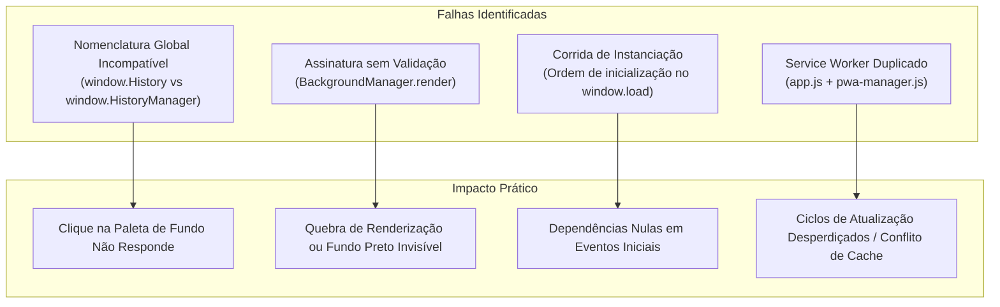

# Relatório Técnico: Falhas Silenciosas em Tempo de Execução e Soluções em Vanilla JavaScript

> **Projeto:** iScrev XBoard  
> **Arquivo:** `src/v2.0/RuntimeErrors-VanillaJS-Report.md`  
> **Status:** Diagnóstico de Qualidade, Resiliência e Manutenibilidade  
> **Versão de Referência:** v1.4.2 $\rightarrow$ v2.0  
> **Autor:** Wandeson Ricardo (WSRicardo)  
> **Data:** Novembro de 2026  

---

## Índice

1. [O Que São "Falhas Silenciosas em Tempo de Execução"?](#1-o-que-são-falhas-silenciosas-em-tempo-de-execução)
2. [Por Que Elas Ocorrem com Frequência em Vanilla JavaScript?](#2-por-que-elas-ocorrem-com-frequência-em-vanilla-javascript)
3. [Mapeamento de Falhas Silenciosas Identificadas no iScrev XBoard](#3-mapeamento-de-falhas-silenciosas-identificadas-no-iscrev-xboard)
   - [3.1. Falha 1: Guarda Condicional Falsa por Inconsistência de Nomenclatura Global (`window.History` vs `window.HistoryManager`)](#31-falha-1-guarda-condicional-falsa-por-inconsistência-de-nomenclatura-global-windowhistory-vs-windowhistorymanager)
   - [3.2. Falha 2: Chamada de Métodos com Assinatura Incompleta (`BackgroundManager.render()`)](#32-falha-2-chamada-de-métodos-com-assinatura-incompleta-backgroundmanagerrender)
   - [3.3. Falha 3: Dependência Implícita de Ordem de Instanciação no DOM (`load`)](#33-falha-3-dependência-implícita-de-ordem-de-instanciação-no-dom-load)
   - [3.4. Falha 4: Registro Duplo Concorrente do Service Worker (`app.js` vs `pwa-manager.js`)](#34-falha-4-registro-duplo-concorrente-do-service-worker-appjs-vs-pwa-managerjs)
   - [3.5. Falha 5: Incompatibilidade Silenciosa de Codecs no Gravador Audiovisual (`MediaRecorder`)](#35-falha-5-incompatibilidade-silenciosa-de-codecs-no-gravador-audiovisual-mediarecorder)
   - [3.6. Falha 6: Falha de Exclusão de RedoStack e Inconsistência de Histórico de Quadros](#36-falha-6-falha-de-exclusão-de-redostack-e-inconsistência-de-histórico-de-quadros)
4. [Soluções Estruturais em Vanilla JavaScript (Sem Migrar para TypeScript)](#4-soluções-estruturais-em-vanilla-javascript-sem-migrar-para-typescript)
   - [4.1. Solução A: Adoção Estrita de ES Modules com Injeção Direta de Dependências](#41-solução-a-adoção-estrita-de-es-modules-com-injeção-direta-de-dependências)
   - [4.2. Solução B: Padrão Mediator / Barramento de Eventos Nativo (`EventTarget`)](#42-solução-b-padrão-mediator--barramento-de-eventos-nativo-eventtarget)
   - [4.3. Solução C: Validação de Parâmetros e Fallbacks em Tempo de Execução (Defensive Coding)](#43-solução-c-validação-de-parâmetros-e-fallbacks-em-tempo-de-execução-defensive-coding)
   - [4.4. Solução D: Checagem Estática Zero-Build via JSDoc + `// @ts-check` (Opcional no Editor)](#44-solução-d-checagem-estática-zero-build-via-jsdoc---ts-check-opcional-no-editor)
   - [4.5. Solução E: Centralizador de Configuração e Constantes Globais Imutáveis (`Object.freeze`)](#45-solução-e-centralizador-de-configuração-e-constantes-globais-imutáveis-objectfreeze)
5. [Plano de Ação e Refatoração para a Versão 2.0](#5-plano-de-ação-e-refatoração-para-a-versão-20)
6. [Conclusão](#6-conclusão)

---

## 1. O Que São "Falhas Silenciosas em Tempo de Execução"?

Em desenvolvimento de software, dividimos os erros em duas categorias fundamentais:
- **Erros Ruidosos (Loud Errors):** Quando o motor do JavaScript lança uma exceção imediata (`TypeError`, `SyntaxError`, `ReferenceError`), interrompe o fluxo e imprime uma mensagem vermelha com stack trace detalhado no console do navegador (`F12`).
- **Falhas Silenciosas (Silent Failures):** Cenários em que o código é sintaticamente válido, o interpretador não quebra, o console não emite erro algum, mas **a funcionalidade simplesmente não opera** ou opera com estado corrompido. O usuário clica em um botão, o sistema aceita a interação, mas a ação visual correspondente (mudar o fundo, salvar a aula, desfazer um traço ou gravar áudio) não acontece.

---

## 2. Por Que Elas Ocorrem com Frequência em Vanilla JavaScript?

O JavaScript possui características dinâmicas que favorecem falhas silenciosas quando o projeto cresce:
1. **Coerção de Tipos e Avaliação Booleana (`truthy` / `falsy`):**
   A expressão `if (window.ObjetoInexistente) { executaAcao(); }` é perfeitamente válida. Se a propriedade não existir, o JavaScript retorna `undefined`, o bloco é ignorado sem nenhum aviso e nada é executado.
2. **Ausência de Contrato Obrigatório em Funções:**
   Uma função definida como `function render(ctx, width, height, config)` pode ser chamada como `render()` sem nenhum argumento. O JavaScript atribui `undefined` a todos os parâmetros sem alertar o desenvolvedor.
3. **Escopo Global Compartilhado (`window.*`):**
   Quando módulos isolados dependem de propriedades injetadas em `window`, qualquer divergência de grafia entre quem define e quem consome a variável resulta em descompasso silencioso.

---

## 3. Mapeamento de Falhas Silenciosas Identificadas no iScrev XBoard

Abaixo estão detalhadas as falhas reais encontradas e catalogadas na base de código do projeto:



---

### 3.1. Falha 1: Guarda Condicional Falsa por Inconsistência de Nomenclatura Global (`window.History` vs `window.HistoryManager`)

- **Localização no Código:**
  - Origem da definição: `src/js/app.js` (linha 27):
    ```javascript
    window.History = new History();
    ```
  - Consumo no evento: `src/js/modules/ui-manager.js` (linhas 86-88 e 96-98):
    ```javascript
    if (window.HistoryManager) {
      window.HistoryManager.setBg({ type, color });
    }
    ```
- **Mecanismo da Falha:**
  O desenvolvedor usou `window.History` na inicialização e checou `window.HistoryManager` na interface. Como `window.HistoryManager` era `undefined`, a condição `if` avaliava para `false`. O modal de seleção de plano de fundo fechava normalmente, dando a impressão ao usuário de que a ação foi registrada, mas a cor nunca mudava e nenhum erro aparecia no console.
- **Severidade:** Alta (quebra de usabilidade de funcionalidade essencial).

---

### 3.2. Falha 2: Chamada de Métodos com Assinatura Incompleta (`BackgroundManager.render()`)

- **Localização no Código:**
  - Definição: `src/js/modules/background-manager.js` (linhas 11-12):
    ```javascript
    render(ctx, width, height, bgConfig) {
      console.log(' start render grid ', ctx);
      ctx.globalCompositeOperation = 'source-over';
      // ...
    }
    ```
  - Chamada problemática: `src/js/app.js` (linhas 21-22):
    ```javascript
    window.BackgroundManager = new BackgroundManager();
    window.BackgroundManager.render(); // Sem parâmetros!
    ```
- **Mecanismo da Falha:**
  O método exige o contexto 2D (`ctx`). Sem ele, o código falha fatalmente com `TypeError: Cannot set properties of undefined (setting 'globalCompositeOperation')`. Quem realmente possui o contexto é o `CanvasEngine` (`this.bgCtx`), e não o inicializador do `app.js`.
- **Severidade:** Alta.

---

### 3.3. Falha 3: Dependência Implícita de Ordem de Instanciação no DOM (`load`)

- **Localização no Código:** `src/js/app.js` (bloco `window.addEventListener('load')`):
  ```javascript
  window.BackgroundManager = new BackgroundManager();
  window.UIManager = new UIManager();       // ⚠️ Registra eventos que chamam window.Engine
  window.Engine = new CanvasEngine('main-canvas'); // ⚠️ Cria o motor gráfico
  window.HistoryManager = new History();    // ⚠️ Cria o histórico
  ```
- **Mecanismo da Falha:**
  O construtor do `UIManager` anexa listeners aos botões da interface imediatamente:
  ```javascript
  this.btnPen.addEventListener('click', () => {
    window.Engine.setTool('pen'); // Se o usuário interagir antes de Engine estar pronto -> Erro fatal
  });
  ```
  Se a ordem de inicialização for ligeiramente alterada ou se um módulo demorar mais para carregar de forma assíncrona, cliques de usuários podem encontrar `window.Engine` como `undefined`.
- **Severidade:** Média/Alta.

---

### 3.4. Falha 4: Registro Duplo Concorrente do Service Worker (`app.js` vs `pwa-manager.js`)

- **Localização no Código:**
  - Arquivo 1: `src/js/modules/pwa-manager.js` (linhas 45-50):
    ```javascript
    registerServiceWorker() {
      if ('serviceWorker' in navigator) {
        navigator.serviceWorker.register('./sw.js').then(...);
      }
    }
    ```
  - Arquivo 2: `src/js/app.js` (linhas 45-50):
    ```javascript
    if ('serviceWorker' in navigator) {
      window.addEventListener('load', () => {
        navigator.serviceWorker.register('./sw.js').then(...);
      });
    }
    ```
- **Mecanismo da Falha:**
  O Service Worker está sendo registrado **duas vezes simultaneamente** ao carregar a página. Embora o navegador consiga deduplicar a instância final, isso gera requisições HTTP redundantes para checar o script `sw.js` e potenciais condições de corrida (*race conditions*) nos eventos `controllerchange` e atualização de cache.
- **Severidade:** Baixa/Média (desperdício de rede e ciclos de processamento).

---

### 3.5. Falha 5: Incompatibilidade Silenciosa de Codecs no Gravador Audiovisual (`MediaRecorder`)

- **Localização no Código:** `src/js/modules/recorder.js` (linhas 60-75):
  ```javascript
  const mimeType = 'video/webm; codecs=vp9,opus';
  this.mediaRecorder = new MediaRecorder(combinedStream, { mimeType });
  ```
- **Mecanismo da Falha:**
  O codec VP9 com áudio Opus é suportado nativamente pelo Chrome e Edge no Desktop, mas pode não ser suportado no Safari (macOS/iOS) ou em navegadores móveis específicos. Se o navegador não suportar o codec especificado e não houver um bloco de fallback verificando `MediaRecorder.isTypeSupported()`, a chamada dispara uma exceção imediata ou grava um arquivo corrompido com 0 bytes sem notificar visualmente o professor.
- **Severidade:** Média.

---

### 3.6. Falha 6: Falha de Exclusão de RedoStack e Inconsistência de Histórico de Quadros

- **Localização no Código:** `src/js/core/history.js` (linhas 25-28 e 146-150):
  ```javascript
  addStroke(stroke) {
    this.currentBoard.strokes.push(stroke);
    this.currentBoard.redoStack = []; // Quebra a arvore de redo
    this.saveToStorage();
  }
  ```
- **Mecanismo da Falha:**
  Ao carregar do armazenamento (`loadFromStorage`), se o JSON salvo anteriormente não possuir a chave `redoStack` em algum quadro antigo de versões anteriores, chamadas posteriores a `this.currentBoard.redoStack.pop()` falham com `Cannot read properties of undefined (reading 'pop')`.
- **Severidade:** Média.

---

## 4. Soluções Estruturais em Vanilla JavaScript (Sem Migrar para TypeScript)

Para resolver essas falhas e blindar o sistema de forma definitiva, **não é necessário adotar TypeScript**. O próprio ecossistema do Vanilla JavaScript moderno (ES6+) dispõe de técnicas arquiteturais elegantes, nativas e robustas:

---

### 4.1. Solução A: Adoção Estrita de ES Modules com Injeção Direta de Dependências

Elimina-se totalmente o uso do objeto `window` para armazenar instâncias de negócio. Os módulos passam a receber suas dependências explicitamente no construtor.

#### Exemplo Prático de Refatoração:

**Antes (`ui-manager.js` legado com variável global solta):**
```javascript
// Ruim: Se window.HistoryManager mudar de nome, falha silenciosamente
if (window.HistoryManager) {
  window.HistoryManager.setBg({ type, color });
}
```

**Depois (`ui-manager.js` moderno com injeção de dependência):**
```javascript
// src/js/modules/ui-manager.js
export class UIManager {
  /**
   * @param {Object} dependencies
   * @param {import('../core/history.js').History} dependencies.historyManager
   * @param {import('../core/canvas-engine.js').CanvasEngine} dependencies.canvasEngine
   */
  constructor({ historyManager, canvasEngine }) {
    if (!historyManager || !canvasEngine) {
      throw new Error('[UIManager] Dependências obrigatórias não foram fornecidas.');
    }
    this.historyManager = historyManager;
    this.canvasEngine = canvasEngine;
    this.bindEvents();
  }

  onBackgroundSelected(type, color) {
    // Uso direto da instância injetada: sem dependência de window!
    this.historyManager.setBg({ type, color });
  }
}
```

---

### 4.2. Solução B: Padrão Mediator / Barramento de Eventos Nativo (`EventTarget`)

Em vez de um módulo chamar diretamente métodos do outro (`UIManager` chamando `History`, que por sua vez chama `Engine`), utiliza-se o `EventTarget` — que é uma classe nativa do Vanilla JavaScript disponível em todos os navegadores modernos sem nenhuma biblioteca externa.

```javascript
// src/js/core/event-bus.js
// 100% Vanilla JS nativo!
export class EventBus extends EventTarget {
  emit(eventName, detail = {}) {
    this.dispatchEvent(new CustomEvent(eventName, { detail }));
  }

  on(eventName, callback) {
    this.addEventListener(eventName, (event) => callback(event.detail));
  }
}

export const appEvents = new EventBus();
```

#### Como isso elimina falhas silenciosas:
- O `UIManager` apenas avisa: `appEvents.emit('background:change', { type, color });`.
- O `CanvasEngine` escuta: `appEvents.on('background:change', (data) => this.drawBackground(data));`.
- Se o `CanvasEngine` ainda não tiver sido instanciado, nada quebra. Os módulos ficam 100% desacoplados.

---

### 4.3. Solução C: Validação de Parâmetros e Fallbacks em Tempo de Execução (Defensive Coding)

Adotar programação defensiva simples dentro dos métodos para garantir valores padrão caso parâmetros sejam omitidos:

```javascript
// src/js/modules/background-manager.js
export class BackgroundManager {
  render(ctx, width, height, bgConfig = {}) {
    // 1. Validação defensiva imediata com mensagem explícita
    if (!ctx || !(ctx instanceof CanvasRenderingContext2D)) {
      console.warn('[BackgroundManager] Tentativa de render sem contexto 2D válido abortada.');
      return;
    }

    // 2. Dimensões padrão seguras se omitidas
    const canvasWidth = width || ctx.canvas?.width || window.innerWidth;
    const canvasHeight = height || ctx.canvas?.height || window.innerHeight;

    // 3. Normalização de configuração com fallback
    const config = {
      type: 'solid',
      color: '#1e1e1e',
      ...(typeof bgConfig === 'string' ? { color: bgConfig } : bgConfig)
    };

    ctx.globalCompositeOperation = 'source-over';
    ctx.fillStyle = config.color;
    ctx.fillRect(0, 0, canvasWidth, canvasHeight);

    if (config.type === 'lines') this.drawLines(ctx, canvasWidth, canvasHeight);
    if (config.type === 'grid') this.drawGrid(ctx, canvasWidth, canvasHeight);
  }
}
```

---

### 4.4. Solução D: Checagem Estática Zero-Build via JSDoc + `// @ts-check` (Opcional no Editor)

Você continua escrevendo arquivos `.js` comuns. Mas adicionando um comentário `// @ts-check` na primeira linha do arquivo e anotações JSDoc simples, o VS Code ou Cursor atua como um assistente em tempo real:

```javascript
// @ts-check
/* src/js/core/canvas-engine.js */

/**
 * @typedef {Object} StrokePoint
 * @property {number} x
 * @property {number} y
 * @property {number} pressure
 */

/**
 * @typedef {Object} Stroke
 * @property {'pen' | 'eraser'} tool
 * @property {string} color
 * @property {number} lineWidth
 * @property {StrokePoint[]} points
 */
```

#### Vantagens:
- **Zero compilação:** O navegador lê o arquivo `.js` diretamente.
- **Autocompletar perfeito:** O editor sugere propriedades válidas e alerta se você digitar `widht` em vez de `width`.
- **Prevenção de erros antes de salvar:** Se você tentar chamar `render()` sem o parâmetro obrigatório, o editor sublinha em vermelho na hora.

---

### 4.5. Solução E: Centralizador de Configuração e Constantes Globais Imutáveis (`Object.freeze`)

Para evitar nomes de eventos e chaves digitados errados em lugares diferentes:

```javascript
// src/js/core/constants.js
export const AppConstants = Object.freeze({
  EVENTS: {
    BG_CHANGE: 'bg:change',
    STROKE_ADDED: 'stroke:added',
    BOARD_CHANGED: 'board:changed',
    HISTORY_UNDO: 'history:undo',
    HISTORY_REDO: 'history:redo'
  },
  TOOLS: {
    PEN: 'pen',
    ERASER: 'eraser'
  },
  DEFAULT_BG: {
    type: 'solid',
    color: '#1e1e1e'
  }
});
```
Se qualquer código tentar alterar ou sobrescrever um valor de `AppConstants`, o JavaScript lançará um erro em modo estrito (`strict mode`).

---

## 5. Plano de Ação e Refatoração para a Versão 2.0

Para sanar todas as falhas silenciosas mapeadas sem sair do Vanilla JavaScript, o roadmap de refatoração para a v2.0 executará os seguintes passos:

| Etapa | Ação Técnica em Vanilla JS | Benefício Direto |
| :---: | :--- | :--- |
| **Passo 1** | Limpeza do `index.html` para carregar apenas `<script type="module" src="js/app.js"></script>`. | Elimina o risco de scripts concorrentes fora de ordem. |
| **Passo 2** | Remover todas as atribuições `window.X = new X()` em favor do padrão de injeção no `app.js`. | Impede divergências de nomes globais como `History` vs `HistoryManager`. |
| **Passo 3** | Centralizar o registro do Service Worker exclusivamente dentro do `pwa-manager.js`. | Remove a duplicação concorrente de registro de cache. |
| **Passo 4** | Adicionar guardas defensivas (`if (!ctx) return;`) nos métodos de renderização visual. | Garante que o sistema nunca trave caso parâmetros venham vazios. |
| **Passo 5** | Adicionar verificação de suporte de codec no gravador (`MediaRecorder.isTypeSupported`). | Garante gravação segura em qualquer navegador e sistema operacional. |
| **Passo 6** | Documentar modelos de dados com anotações JSDoc nativas. | Oferece autocomplete e validação visual de tipagem no editor sem exigir TypeScript. |

---

## 6. Conclusão

A migração para TypeScript **não é obrigatória** para alcançar excelência e robustez no iScrev XBoard. As falhas silenciosas observadas na transição v1.4.1 $\rightarrow$ v1.4.2 não eram limitações da linguagem JavaScript, mas sim reflexo de:
1. Uso residual do objeto global `window` para orquestração de dependências;
2. Ausência de validações defensivas em parâmetros de entrada;
3. Ordem de carregamento procedural de scripts soltos no HTML.

Com a arquitetura proposta baseada em **ES Modules nativos**, **Injeção de Dependências**, **EventTarget nativo** e anotações **JSDoc**, o iScrev XBoard v2.0 atinge o mais alto nível de estabilidade e manutenibilidade mantendo-se **100% fiel à simplicidade, velocidade e liberdade do Vanilla JavaScript**.
