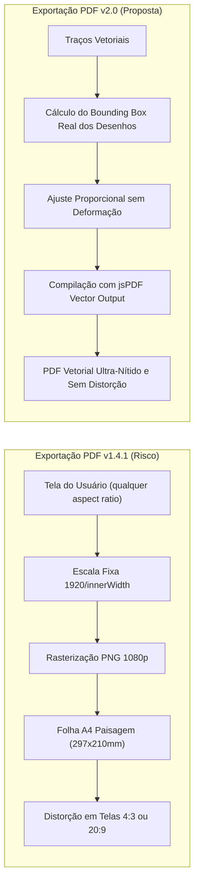
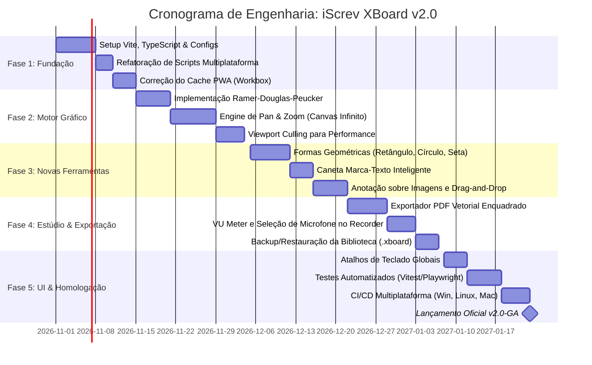

# Esquema de Desenvolvimento & Roadmap Técnico: iScrev XBoard v2.0

> **Documento:** Mapa Estratégico de Evolução, Melhorias e Refatoração Técnica (`SchemeDev20.md`)  
> **Versão de Referência:** iScrev XBoard v1.4.1 $\rightarrow$ v2.0  
> **Autor & Idealizador:** Wandeson Ricardo (WSRicardo)  
> **Localização:** `src/v2.0/SchemeDev20.md`  
> **Status:** Planejamento e Arquitetura de Especificação  

---

## 1. Visão Geral e Diretrizes da Versão 2.0

A versão 1.4.1 do **iScrev XBoard** consolidou com sucesso os fundamentos da aplicação: uma lousa digital funcional em Vanilla JS, operando de maneira híbrida como PWA e aplicativo Desktop Electron, com renderização via curvas de Bézier e persistência local no IndexedDB.

No entanto, o crescimento orgânico de funcionalidades (biblioteca de aulas, visualizador multimídia, gravador de vídeo e exportação PDF) gerou acoplamento estrutural e débitos técnicos que limitam a escalabilidade do software.

O objetivo da **Versão 2.0** é transformar o XBoard em uma **suíte profissional de ilustração e ensino digital**, orientada por quatro pilares:
1. **Modularidade e Robustez Estrutural:** Desacoplamento total do objeto global `window`, adoção de ES Modules e tipagem estrita com TypeScript.
2. **Alta Performance e Eficiência Vetorial:** Algoritmos de simplificação de traços (RDP), tela infinita com aceleração de hardware e pan/zoom fluido.
3. **Expansão de Capacidades Didáticas:** Formas geométricas, caneta marca-texto inteligente, caixas de texto tipográfico e camadas (layers).
4. **Confiabilidade de Dados e Cache PWA:** Sincronização offline à prova de falhas com Workbox, backup/exportação de aulas e exportação de PDF vetorial sem distorções de proporção.

---

## 2. Matriz de Priorização (Metodologia MoSCoW)

```mermaid
quadrantChart
    title Matriz de Priorização: Impacto vs Complexidade
    x-axis Baixa Complexidade --> Alta Complexidade
    y-axis Baixo Impacto --> Alto Impacto
    quadrant-1 Prioridade Estrutural (Fase 2)
    quadrant-2 Vitórias Rápidas (Fase 1)
    quadrant-3 Melhorias Secundárias (Fase 4)
    quadrant-4 Recursos Complexos (Fase 3)
    "Correção de Cache no SW": [0.15, 0.90]
    "Build Multiplataforma (remover PowerShell)": [0.10, 0.70]
    "Atalhos de Teclado Globais": [0.25, 0.75]
    "Migração para Vite + ESM": [0.45, 0.95]
    "Tipagem TypeScript": [0.55, 0.85]
    "Simplificação Ramer-Douglas-Peucker": [0.40, 0.90]
    "Pan & Zoom (Canvas Infinito)": [0.70, 0.95]
    "Formas Geométricas & Linhas Retas": [0.50, 0.80]
    "Caneta Marca-Texto Real": [0.35, 0.70]
    "PDF Vetorial Sem Distorção": [0.60, 0.85]
    "Backup/Restauração de Biblioteca (.xboard)": [0.30, 0.80]
    "Camadas de Desenho (Layers)": [0.75, 0.65]
    "Colaboração em Tempo Real (WebRTC)": [0.90, 0.50]
```

| Classificação | Melhoria / Funcionalidade | Eixo Técnico | Impacto |
| :--- | :--- | :--- | :--- |
| **Must Have (Crítico)** | Correção imediata de cache no Service Worker (`urlsToCache`) | Infraestrutura / PWA | Previne quebra offline |
| **Must Have (Crítico)** | Modularização via Vite + ES Modules (eliminar `window.*`) | Arquitetura | Manutenibilidade |
| **Must Have (Crítico)** | Scripts de build multiplataforma (eliminar PowerShell) | DevEx / CI/CD | Compatibilidade Linux/Mac |
| **Must Have (Crítico)** | Simplificação poligonal de traços (Ramer-Douglas-Peucker) | Motor Gráfico | Reduz RAM em até 70% |
| **Should Have (Alto)** | Suporte a Pan & Zoom (Canvas Infinito bidimensional) | Motor Gráfico / UX | Amplitude de escrita |
| **Should Have (Alto)** | Formas geométricas básicas (retângulos, círculos, setas) | Ferramentas | Qualidade didática |
| **Should Have (Alto)** | Correção de proporção (Aspect Ratio) no exportador PDF | Mídia / Exportação | Elimina distorções |
| **Should Have (Alto)** | Sistema completo de atalhos de teclado (`Ctrl+Z`, `P`, `E`, etc.) | UI / Produtividade | Velocidade de aula |
| **Should Have (Alto)** | Backup completo da biblioteca de aulas em arquivo exportável | Armazenamento | Segurança de dados |
| **Could Have (Médio)** | Caneta Marca-Texto inteligente (blend mode multiply) | Ferramentas | Anotação sobre textos |
| **Could Have (Médio)** | Inserção de imagens por drag-and-drop e Ctrl+V | Mídia | Praticidade |
| **Could Have (Médio)** | Caixa de texto tipográfico editável na prancheta | Ferramentas | Legibilidade |
| **Could Have (Médio)** | Suporte a camadas visuais (Layers) | Motor Gráfico | Organização avançada |
| **Won't Have (v2.0)** | Colaboração multiusuário em tempo real via WebSockets/WebRTC | Backend | Reservado para v3.0 |

---

## 3. Mapeamento Detalhado dos Pontos de Melhoria

### 3.1. Eixo 1: Arquitetura de Software, Build e Modularização

#### Ponto Crítico Atual
Atualmente, todo o sistema é carregado via 11 tags `<script>` sequenciais em `src/index.html`. O acoplamento se dá expondo instâncias únicas no objeto global:
```javascript
window.Engine = new CanvasEngine('main-canvas');
window.HistoryManager = new History();
window.StorageService = new StorageService();
window.UIManager = new UIManager();
```
Essa abordagem impede testes unitários automatizados, favorece efeitos colaterais ocultos e cria dependência estrita da ordem de importação no HTML.

#### Mudanças Recomendadas para a v2.0
1. **Adoção do Vite como Bundler Oficial:**
   - Tempo de inicialização em milissegundos com Hot Module Replacement (HMR).
   - Suporte nativo a ES Modules (`import { CanvasEngine } from './core/canvas-engine'`).
   - Geração de pacote otimizado para produção com minificação e *tree-shaking*.
2. **Migração Gradual para TypeScript:**
   - Criar definições de tipos para contratos cruciais:
     ```typescript
     export interface Point {
       x: number;
       y: number;
       pressure: number;
     }

     export interface Stroke {
       id: string;
       tool: 'pen' | 'eraser' | 'highlighter' | 'shape';
       color: string;
       lineWidth: number;
       points: Point[];
       shapeConfig?: ShapeConfig;
     }

     export interface Board {
       id: number;
       strokes: Stroke[];
       redoStack: Stroke[];
       bg: BackgroundConfig;
     }
     ```
3. **Injeção de Dependências ou Event Bus:**
   - Substituir o acesso global direto por um padrão de Event Bus ou Mediação (ex: `eventBus.emit('stroke:added', stroke)`), eliminando chamadas como `window.UIManager.updateBoardCounter()`.
4. **Scripts de Build 100% Multiplataforma:**
   - No [package.json](file:///c:/Users/wsric/OneDrive/Documentos/GitHub/iScrev-XBoard/package.json), substituir o comando PowerShell:
     ```json
     // Antes (v1.4.1 - Falha no Linux e Mac):
     "build:web": "powershell -Command \"New-Item -ItemType Directory -Force -Path build_web; Copy-Item -Path src\\* -Destination build_web -Recurse -Force\""

     // Depois (v2.0 - Universal):
     "build:web": "vite build --outDir dist-web"
     ```

---

### 3.2. Eixo 2: Motor Gráfico, Desempenho e Eficiência Vetorial

```mermaid
graph TD
    subgraph "Pipeline Atual (v1.4.1)"
        Input1["Entrada Stylus/Mouse"] --> Filter1["Filtro dx² + dy² < 4"]
        Filter1 --> Store1["Grava TODOS os pontos no Array"]
        Store1 --> HighRAM["Alto Consumo de RAM & JSON Gigantes"]
    end

    subgraph "Pipeline Proposto (v2.0)"
        Input2["Entrada Stylus/Mouse"] --> Filter2["Filtro em Tempo Real"]
        Filter2 --> LiveRender["Renderização Fluida (Bézier)"]
        LiveRender --> OnPointerUp["Evento PointerUp"]
        OnPointerUp --> RDP["Algoritmo Ramer-Douglas-Peucker (Epsilon = 1.0)"]
        RDP --> OptimizedStore["Redução de até 70% dos Pontos"]
        OptimizedStore --> LowRAM["Memória RAM Estável & Persistência Ágil"]
    end
```



#### Melhorias Recomendadas para a v2.0
1. **Algoritmo de Simplificação Ramer-Douglas-Peucker (RDP):**
   - Durante a escrita, o usuário necessita de feedback imediato a 60 FPS.
   - Ao soltar o ponteiro (`pointerup`), o array de pontos deve passar por simplificação matemática, eliminando pontos colineares ou com deflexão inferior a uma tolerância $\epsilon \approx 0.8\text{px}$.
   - **Benefício:** Reduz o tamanho dos dados salvos no IndexedDB em até 70% sem qualquer alteração na fidelidade visual.
2. **Canvas Infinito com Pan & Zoom:**
   - Adicionar uma matriz de visualização:
     ```javascript
     ctx.setTransform(scale, 0, 0, scale, offsetX, offsetY);
     ```
   - Permitir navegação espacial:
     - **Zoom:** `Ctrl + Scroll` do mouse ou pinça com 2 dedos em telas touch.
     - **Pan:** Ferramenta Mão (`Hand Tool`), segurar a barra de espaço ou arrastar com 2 dedos.
     - Botão de atalho rápido na UI: *"Redefinir visualização (100% / Ajustar à Tela)"*.
3. **Novas Ferramentas de Desenho:**
   - **Formas Geométricas Inteligentes:** Ferramentas de Retângulo, Círculo/Elipse, Linha Reta e Seta (com renderização de ponta vetorial precisa).
   - **Caneta Marca-Texto (Highlighter):** Linha semi-transparente que usa composição `globalCompositeOperation = 'multiply'` em fundos claros ou cálculo de luminância em fundos escuros para destacar o conteúdo sem cobrir os traços existentes.
   - **Modo Régua / Traço Reto Forçado:** Segurar tecla `Shift` enquanto desenha com a caneta restringe o traço a ângulos retos (0°, 45°, 90°).

---

### 3.3. Eixo 3: Persistência de Dados, Confiabilidade e Armazenamento

#### Diagnóstico Atual
- O IndexedDB salva a sessão ativa através de um debounce de 1 segundo. Contudo, não há verificação de cota de armazenamento (`navigator.storage.estimate()`), nem rotinas de migração de versão caso a estrutura de dados mude.
- O Service Worker atual (`src/sw.js`) possui lista estática desatualizada que omite arquivos essenciais criados nas últimas versões.

#### Melhorias Recomendadas para a v2.0
1. **Service Worker Automatizado com Vite-Plugin-PWA / Workbox:**
   - Eliminar a edição manual de `urlsToCache` e strings de versão como `'xboard-cache-v2.4'`.
   - O bundler deve compilar automaticamente o manifesto de pré-cache contendo hashes MD5 de todos os arquivos gerados.
2. **Sistema de Backup & Restauração da Biblioteca:**
   - Exportar a biblioteca inteira de aulas em um arquivo compactado único: `.xboard` (contendo os JSONs das aulas e metadados).
   - Permitir que o professor faça backup no Google Drive/Pen Drive e restaure suas aulas em outro computador com 1 clique.
3. **Indicador de Status de Persistência na UI:**
   - Criar um micro-indicador de estado discreto na barra de ferramentas:
     - 🟢 *Tudo salvo localmente*
     - 🟡 *Salvando alterações...*
     - 🔴 *Atenção: Armazenamento local cheio*

---

### 3.4. Eixo 4: Estúdio Audiovisual, Exportação e Recursos Multimídia



#### Melhorias Recomendadas para a v2.0
1. **Exportação de PDF Vetorial com Enquadramento Inteligente:**
   - Em vez de apenas tirar uma foto PNG do canvas atual e esticar na folha A4, a v2.0 deve calcular a caixa delimitadora (*Bounding Box*) de todos os traços do quadro.
   - Ajustar o conteúdo centralizado na proporção da folha A4 (297 x 210 mm) com margens proporcionais.
   - Para traços geométricos e textos, emitir primitivas vetoriais nativas do jsPDF (`doc.lines()`, `doc.rect()`), gerando PDFs menores e com qualidade de impressão infinita.
2. **Aprimoramentos no Gravador Audiovisual (`recorder.js`):**
   - **Seleção de Dispositivo:** Menu suspenso para escolher qual microfone utilizar quando houver múltiplos periféricos conectados.
   - **Indicador de Tempo e Decibéis (VU Meter):** Exibir tempo decorrido de gravação (`00:15:32`) e barra visual de intensidade da voz para que o instrutor saiba se o microfone está captando áudio.
   - **Pausar Gravação:** Adicionar funcionalidade `mediaRecorder.pause()` e `resume()`.
3. **Anotação Direta sobre Imagens Importadas:**
   - Permitir arrastar e soltar (drag-and-drop) ou colar via `Ctrl+V` imagens (diagramas, mapas, exercícios) diretamente para a prancheta.
   - A imagem torna-se um objeto manipulável (mover, redimensionar) com suporte para desenhar por cima.

---

### 3.5. Eixo 5: Interface do Usuário (UI/UX) e Produtividade

#### Diagnóstico Atual
A toolbar em Glassmorphism é visualmente atraente e conta com gaveta responsiva para mobile. No entanto, faltam atalhos de teclado universais que professores costumam utilizar com mesas digitalizadoras e teclados sem fio.

#### Mudanças Recomendadas para a v2.0
1. **Mapeamento de Atalhos de Teclado Globais:**

| Tecla / Combinação | Ação Executada |
| :--- | :--- |
| `Ctrl + Z` | Desfazer (*Undo*) |
| `Ctrl + Y` ou `Ctrl + Shift + Z` | Refazer (*Redo*) |
| `P` | Selecionar Caneta (*Pen*) |
| `E` | Selecionar Borracha (*Eraser*) |
| `H` ou `Espaço (segurar)` | Mão de Navegação (*Pan Tool*) |
| `[` e `]` | Diminuir / Aumentar espessura da ponta |
| `1` a `6` | Cores pré-definidas da paleta rápida |
| `Page Down` / `Seta Direita` | Próximo Quadro (*Next Board*) |
| `Page Up` / `Seta Esquerda` | Quadro Anterior (*Previous Board*) |
| `F11` | Alternar Modo Tela Cheia |
| `Ctrl + S` | Abrir diálogo de salvar aula na biblioteca |
| `Delete` | Limpar prancheta ativa (com confirmação) |

2. **Mini-Paleta Flutuante de Contexto:**
   - Quando o usuário toca na tela com caneta stylus ativa (usando o botão lateral da caneta), abre-se um pequeno menu radial ou mini-toolbar no ponto do toque para trocar cor e espessura sem precisar mover o braço até a barra inferior.
3. **Temas de Cor da Interface:**
   - Oferecer seletor rápido de tema para o ambiente da lousa:
     - **Modo Escuro Clássico (Padrão):** Fundo cinza escuro/grafite com traço claro.
     - **Modo Lousa Tradicional:** Verde lousa escolar clássico (`#1b3b2b`) com giz branco e colorido.
     - **Modo Claro (Whiteboard):** Fundo branco suave com canetas marcadoras azul, preta e vermelha.

---

### 3.6. Eixo 6: Integração Desktop Nativa (Electron)

#### Diagnóstico Atual
O [main.js](file:///c:/Users/wsric/OneDrive/Documentos/GitHub/iScrev-XBoard/main.js) e [preload.js](file:///c:/Users/wsric/OneDrive/Documentos/GitHub/iScrev-XBoard/preload.js) funcionam de forma mínima. O `preload.js` expõe um objeto vazio no momento.

#### Mudanças Recomendadas para a v2.0
1. **Ponte IPC Completa via ContextBridge:**
   - Integrar caixas de diálogo nativas do sistema operacional para salvar e abrir arquivos:
     ```javascript
     // No preload.js
     contextBridge.exposeInMainWorld('electronAPI', {
       saveFileNative: (options) => ipcRenderer.invoke('dialog:saveFile', options),
       openFileNative: (options) => ipcRenderer.invoke('dialog:openFile', options),
       toggleFullscreen: () => ipcRenderer.invoke('window:toggleFullscreen'),
       getAppVersion: () => ipcRenderer.invoke('app:getVersion')
     });
     ```
2. **Menu de Bandeja do Sistema (System Tray):**
   - Permitir minimizar a lousa para a bandeja do Windows ao invés de fechar, acelerando o retorno durante intervalos de aula.
3. **Distribuição Multiplataforma via GitHub Actions:**
   - Expandir o workflow de release para gerar executáveis para:
     - **Windows:** NSIS Installer e Portable (existentes).
     - **Linux:** Pacotes `.AppImage` e `.deb`.
     - **macOS:** Pacote `.dmg` universal (Apple Silicon e Intel).

---

## 4. Tabela de Riscos Técnicos e Estratégias de Mitigação

| Risco Técnico Identificado | Severidade | Impacto Potencial | Estratégia de Mitigação na v2.0 |
| :--- | :---: | :--- | :--- |
| **Gargalo de memória em aulas extensas** | Alta | Queda brusca de FPS e lentidão em sessões com milhares de traços | Implementação de simplificação Ramer-Douglas-Peucker + *off-screen culling* (não desenhar traços fora da viewport visível). |
| **Corrupção de dados no IndexedDB** | Média | Perda de notas do professor em caso de desligamento abrupto | Uso de transações com controle estrito de commit e exportação automática de snapshots de emergência. |
| **Incompatibilidade de áudio no Safari / iOS** | Média | O módulo `Recorder` não grava som ou falha no navegador móvel da Apple | Detecção de suporte via `MediaRecorder.isTypeSupported` e exibição de alerta de orientação amigável. |
| **Regressão de usabilidade para usuários leigos** | Baixa | Usuários acostumados com a simplicidade da v1.4.1 se perderem em novos menus | Manter a barra de ferramentas padrão simples e limpa; disponibilizar novas ferramentas em submenus expansíveis. |

---

## 5. Cronograma e Fases de Execução da Versão 2.0



### Detalhamento das Etapas:
1. **Fase 1 — Fundação & Desacoplamento (Semanas 1 e 2):**
   - Inicialização do ambiente Vite com TypeScript na pasta de desenvolvimento.
   - Migração dos módulos legados para sintaxe ES Modules (`import`/`export`), eliminando todas as referências no escopo `window`.
   - Automação da compilação do Service Worker com pré-cache estrito de 100% dos assets.
2. **Fase 2 — Otimização do Motor Gráfico (Semanas 3 e 4):**
   - Integração da simplificação RDP no evento `pointerup`.
   - Implementação da matriz de transformação de visualização (Pan & Zoom com suporte a toque e atalhos).
   - Teste de estresse com 50.000 pontos contínuos para garantir 60 FPS estáveis.
3. **Fase 3 — Novas Ferramentas Didáticas (Semanas 5 e 6):**
   - Criação das ferramentas de formas geométricas e linhas ortogonais (`Shift`).
   - Implementação do algoritmo de marca-texto sem ocultação de linhas pretas.
   - Suporte a colar imagens diretamente da área de transferência (`Ctrl+V`).
4. **Fase 4 — Refinamento de Mídia & Dados (Semanas 7 e 8):**
   - Reescrita do `pdf-exporter.js` para enquadramento inteligente e proporção A4 pura.
   - Interface de controle de microfone e nível de volume para a gravação.
   - Formato de empacotamento `.xboard` para exportação de biblioteca.
5. **Fase 5 — Interface, Atalhos e Validação (Semanas 9 e 10):**
   - Mapeamento completo dos atalhos de teclado para professores e palestrantes.
   - Criação de testes unitários para a máquina de estados e cálculos geométricos.
   - Compilação dos instaladores desktop e deploy do PWA v2.0.

---

<div align="center">
  <sub>Este documento constitui o mapa estratégico oficial para a engenharia da versão 2.0 do iScrev XBoard.</sub>
</div>
